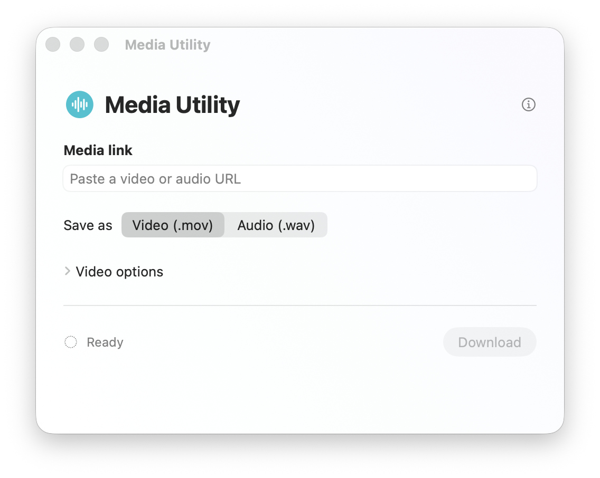

# Media Utility

**Графический интерфейс для yt-dlp на macOS.** Вставьте ссылку, чтобы сохранить видео в MOV или извлечь звук в WAV. Медиапотоки находит и скачивает yt-dlp. Дорожки анализирует ffprobe, а объединяет и преобразует FFmpeg. Всё это выполняется на вашем Mac. [Проект yt-dlp](https://github.com/yt-dlp/yt-dlp) · [Проект FFmpeg](https://ffmpeg.org/)

Media Utility добавляет окно на SwiftUI, выбор дорожек и качества, обработку cookies и безопасное сохранение результата. В комплекте есть команда для пакетной загрузки.



## Установка на Mac

Понадобятся macOS 14 или новее, полный Xcode с поддержкой формата проекта Xcode 16, а также [Homebrew](https://brew.sh/). При первом использовании откройте Xcode, чтобы установить его компоненты.

1. Скачайте [ZIP с исходниками](https://github.com/dennech/media-utility/archive/refs/heads/main.zip) и распакуйте архив. Если пользуетесь Git, подойдёт обычный клон.
2. Откройте Терминал в распакованной папке. Установите зависимости и закреплённую версию загрузчика:

   ```sh
   brew install python ffmpeg deno
   ./script/install-tools.sh
   ```

3. Соберите и откройте приложение:

   ```sh
   ./script/build_and_run.sh
   ```

Дальше приложение можно открывать двойным щелчком. Оно лежит в `build/ReleaseBuild/Build/Products/Release/Media Utility.app`. Можно перенести его в «Программы». Команда с параметром `--build` только собирает приложение. Это локальная сборка из исходников. Готового установщика с нотариальным заверением Apple пока нет.

## Загрузка

Вставьте ссылку, выберите формат и нажмите **Download**. Приложение предложит имя и папку. Работают источники, которые распознаёт установленная версия yt-dlp, включая YouTube и ряд встроенных плееров. Доступность конкретного ролика зависит от сайта, региона и условий доступа.

- **Video (.mov)** сохраняет совместимые дорожки без повторного кодирования. В разделе **Video options** можно выбрать качество перекодирования в H.264.
- **Audio (.wav)** сохраняет PCM, 16 бит, с частотой исходной аудиодорожки. При наличии нескольких языков приложение учитывает исходный язык по метаданным. Для источника только со звуком приложение само предлагает WAV.
- **Cancel** останавливает задачу. Готовый MOV или WAV занимает выбранное место после успешной конвертации. При ошибке или отмене прежний файл сохраняется.

### Несколько ссылок в терминале

```sh
python3 download_youtube.py --output-dir ~/Downloads 'MEDIA_URL_1' 'MEDIA_URL_2'
```

Подставьте адреса в кавычках. По умолчанию скрипт создаёт MOV и предпочитает AAC среди отдельных аудиодорожек. Параметр `--output-container mkv` сохраняет MKV, `--keep-intermediate` оставляет исходный MKV рядом с MOV, `--force` разрешает заменить существующий результат. Остальные параметры показывает `python3 download_youtube.py --help`.

## Доступ к аккаунту и приватность

Обычная загрузка начинается анонимно. У приложения нет доступа к профилю Chrome через интерфейс. Локальный загрузчик запускается с отключёнными пользовательской конфигурацией, сторонними плагинами и загрузкой дополнительных программных компонентов. Для проверки номера последнего стабильного релиза приложение обращается к GitHub.

Если сайт требует входа, лучше использовать отдельный профиль браузера, в котором выполнен вход только на нужный сайт. По возможности используйте отдельный аккаунт. Экспорт cookies содержит действующие ключи сеанса. Держите его вне папки проекта и общих облачных папок. Если файл попал к посторонним, завершите соответствующие сеансы в настройках аккаунта.

Окно показывает имя сайта. Можно отказаться или вручную выбрать экспорт в формате Netscape. Для CLI используется `--cookies /path/to/export.txt`. Каждая ссылка получает отдельную временную копию подходящих записей. Оригинал остаётся у владельца. Для авторизации используйте полную HTTPS-ссылку на страницу ролика. Сокращённый адрес может вести на другой домен.

В режиме с cookies сетевые запросы обслуживает встроенный клиент. Перед отправкой на другой адрес сайта (схема, имя хоста или порт) его HTTP-транспорт удаляет заголовки Cookie и Authorization. Внешние сетевые загрузчики и JavaScript-помощники для этого режима отключены. Некоторые сайты поэтому доступны только анонимно или через собственную функцию скачивания. Приложение по-прежнему доверяет коду выбранного выпуска yt-dlp и установленным локальным инструментам.

## Версия yt-dlp

Версия и SHA-256 записаны в [файле закрепления](YouTubeUtilityApp/yt-dlp-lock.json). Установщик скачивает официальный Unix-архив в пользовательскую папку Application Support. Перед запуском проверяются именно те байты, из которых будет загружен код. Универсальный Python-архив выполняется в изолированном режиме. Homebrew предоставляет Python, FFmpeg и необязательный Deno для некоторых анонимных загрузок. Системная команда yt-dlp может иметь другую версию.

При пересмотре версии проверьте [релизы](https://github.com/yt-dlp/yt-dlp/releases), [уведомления безопасности](https://github.com/yt-dlp/yt-dlp/security/advisories) и сообщения о проблемах. Правила работы с cookies привязаны к сетевому коду проверенного релиза и требуют повторной проверки при обновлении.

## Файлы проекта

| Где | Что внутри |
| --- | --- |
| [YouTubeUtilityApp/](YouTubeUtilityApp/) | Интерфейс SwiftUI, загрузка, конвертация, настройки и изолированный запуск yt-dlp |
| [YouTubeUtilityApp.xcodeproj/](YouTubeUtilityApp.xcodeproj/) | Проект для открытия в Xcode |
| [download_youtube.py](download_youtube.py) | Пакетная загрузка через терминал |
| [script/](script/) | Установка закреплённого загрузчика и сборка приложения |
| [tests/](tests/) | Проверки сохранения и обработки сеансов на искусственных данных |

Сборки попадают в `build/`. Рабочие медиа, результаты загрузок, экспорт cookies и настройки инструментов разработки в состав исходников для публикации не входят.

## Участники

- [@dennech](https://github.com/dennech) — автор и сопровождающий проекта.
- [OpenAI Codex](https://openai.com/codex/) — ИИ-помощник при разработке, ревью кода и подготовке проверок.

### Проекты, на которых основано приложение

Спасибо разработчикам и сопровождающим yt-dlp и FFmpeg. Основной код yt-dlp опубликован под Unlicense. Официальный Unix-архив выбранного выпуска также включает компоненты под MIT и ISC. Установщик получает его непосредственно у разработчиков. [Лицензия yt-dlp](https://github.com/yt-dlp/yt-dlp/blob/2026.10.21/LICENSE) · [Состав и лицензии выпуска](https://github.com/yt-dlp/yt-dlp/releases/tag/2026.10.21)

FFmpeg и входящий в его состав ffprobe устанавливаются отдельно. Лицензия конкретной сборки FFmpeg зависит от включённых компонентов. [Лицензирование FFmpeg](https://ffmpeg.org/legal.html)

## Проверки и лицензия

После установки зависимостей запустите `./tests/run-checks.sh`. Проверки используют искусственные файлы и тестовые значения cookies.

Код Media Utility распространяется по лицензии [MIT](LICENSE). Отдельно устанавливаемые yt-dlp, FFmpeg, Python и Deno распространяются на условиях своих проектов.
